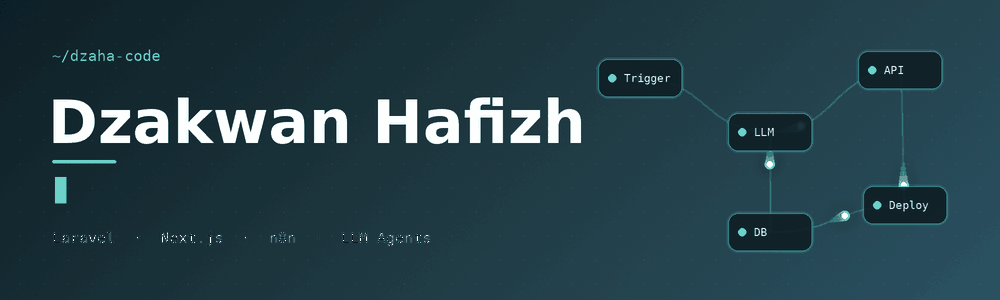

 

 

I build full-stack web applications and wire AI into the workflows around them, from Laravel back ends to Next.js interfaces to n8n automations. I care about small, reliable systems with interfaces that stay out of the way.

**Right now:** exploring LLM agents, workflow automation with n8n, and design systems.
**Open to:** collaboration on web development and AI automation projects.

 

## Stack

 

 

  

 

## Projects

<table>
<tr>
<td width="50%" valign="top">

**[Creplann](https://github.com/Dzaha-code/Creplann)**
Weekly planner that turns scattered tasks and deadlines into one structured week.
Laravel · Breeze · Tailwind · MySQL · Vite

</td>
<td width="50%" valign="top">

**[Flex Study](https://github.com/Dzaha-code/Flex-Study)**
Local-first desktop study planner: the next time block is the only thing on screen. No account, no server.
Tauri 2 · Next.js 16 · React 19 · TypeScript · Dexie

</td>
</tr>
</table>

 

## Activity

  

<picture>
  <source media="(prefers-color-scheme: dark)" srcset="https://raw.githubusercontent.com/Dzaha-code/Dzaha-code/output/github-snake-dark.svg"/>
  <source media="(prefers-color-scheme: light)" srcset="https://raw.githubusercontent.com/Dzaha-code/Dzaha-code/output/github-snake.svg"/>
  
</picture>

